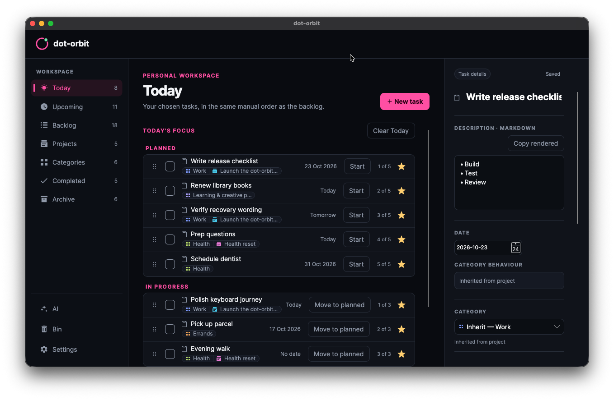

<h1> dot-orbit</h1>

A personal, open-source desktop task manager for organising projects, choosing a deliberate daily focus, and keeping work in your own order.

[](https://github.com/nullabletype/dot-orbit/actions/workflows/build.yml?query=branch%3Amain)
[](https://github.com/nullabletype/dot-orbit/actions/workflows/release-packages.yml?query=branch%3Amain)
[](LICENSE)

[Website](https://dot-orbit.app/) · [Download](https://github.com/nullabletype/dot-orbit/releases)



dot-orbit keeps personal planning local. Create Projects and standalone Tasks, decide what belongs in Today, and arrange work in the order that makes sense to you. Your workspace is encrypted on your computer, with no account or hosted service required.

## Highlights

- **Choose today deliberately.** Build a focused Today list without forcing every Task onto a due date.
- **Keep work connected.** Organise Tasks with Projects, Categories, and reusable Participants.
- **See the same work from different angles.** Use Today, Upcoming, Backlog, Completed, Archive, and Bin without duplicating Tasks.
- **Keep your data local.** Use an encrypted workspace with configurable automatic recovery, portable recovery points, passphrase rotation, and explicit plaintext JSON export.
- **Review assisted planning before it changes anything.** Copy a Planning snapshot for an external tool, then validate, review, and explicitly approve any returned proposal inside dot-orbit.
- **Make it comfortable.** Use Markdown descriptions, keyboard navigation, manual ordering, and built-in light and dark themes.

## Download and run

Download the archive for your system from [GitHub Releases](https://github.com/nullabletype/dot-orbit/releases):

| System | Archive |
| --- | --- |
| Windows x64 | `dot-orbit-win-x64.zip` |
| Linux x64 using X11 | `dot-orbit-linux-x64.tar.gz` |
| macOS on Apple silicon | `dot-orbit-osx-arm64.tar.gz` |
| macOS on Intel | `dot-orbit-osx-x64.tar.gz` |

The archives are self-contained, so a separate .NET installation is not required. Extract the archive and run `dot-orbit.exe` on Windows or `./dot-orbit` on macOS and Linux. The packaged `dot-orbit-mcp` adapter is included beside the desktop application.

On first launch, create a new encrypted workspace or choose an existing workspace file. Keep the passphrase safe: dot-orbit does not persist it and cannot recover it. Configure encrypted recovery points from **Settings → Recovery**.

Releases are currently portable archives without platform-trusted publisher signing rather than installers or macOS application bundles. Windows may show its normal first-run warning. Official releases can check GitHub Releases for newer versions, but update discovery is notice-only: dot-orbit never downloads or installs an update automatically.

### macOS first run

The .NET SDK gives the macOS executables an ad hoc Mach-O signature, but they are not signed with an Apple Developer ID or notarised. macOS therefore cannot verify the developer or check them through Apple's notarisation service. Only continue if you downloaded the archive from the official dot-orbit GitHub release. After extracting it, run `./dot-orbit` from Terminal. If macOS blocks it, open **System Settings → Privacy & Security**, choose **Open Anyway** for the blocked item, then confirm **Open**. The optional `dot-orbit-mcp` adapter is a separate executable and may need the same one-time approval when it first runs. Do not disable Gatekeeper globally. See [Apple's guidance](https://support.apple.com/en-gb/guide/mac-help/mh40617/mac) for the current steps.

## Optional local MCP

AI features are off by default. Enabling them does not contact an AI provider. Local MCP is a separate opt-in setting that works only while the desktop application is running with an unlocked workspace.

In **Settings**, enable **AI features**, enable **local MCP**, and wait for its status to show **Running**.

Configure an MCP host to launch the `dot-orbit-mcp` executable from the same release archive. Use an absolute path, a stable profile name, and one or both scopes:

```json
{
  "command": "/absolute/path/to/dot-orbit-mcp",
  "args": [
    "--stdio",
    "--profile", "personal",
    "--client-name", "My MCP host",
    "--client-version", "1.0",
    "--scope", "read",
    "--scope", "submit"
  ]
}
```

The `read` scope exposes reusable proposal instructions and the current Planning snapshot. The `submit` scope can place New-work or Change proposals into the encrypted review queue, but it cannot approve or apply them. The first connection identifies the operating-system account separately from the host's self-reported name and version and asks whether to allow it once or remember it.

Adapter credentials are stored in Windows Credential Manager, macOS Keychain, or Linux Secret Service; there is no plaintext fallback. See the [local MCP guide](docs/development/local-mcp.md) for scopes, profiles, revocation, security boundaries, and troubleshooting.

## Build from source

Building requires Node.js and the .NET SDK; the repository pins .NET SDK 10.0.403 in [`global.json`](global.json). Prepare a checkout and generate its isolated sample workspace with:

```sh
node tools/setup-workspace.mjs
```

Launch the application against that sample:

```sh
dotnet run --project src/DotOrbit.Desktop/DotOrbit.Desktop.csproj -- --sample-workspace
```

Run the canonical repository gate with:

```sh
dotnet run --project tools/DotOrbit.Verification/DotOrbit.Verification.csproj -p:RestoreLockedMode=true
```

The gate performs a locked restore, dependency audits, formatting verification, a deterministic Release build, all .NET tests, the native desktop smoke journey, and its negative controls. The **Build** badge above reports the combined Node and .NET build, test, and native smoke status across Ubuntu, Windows, macOS Apple silicon, and macOS Intel.

## Project documentation

- [Product brief](docs/product/brief.md) and [behavioural requirements](docs/product/requirements.md)
- [UI specification](docs/design/ui-specification.md) and [component style guide](docs/design/style-guide.md)
- [System context](docs/architecture/system-context.md) and [architectural decisions](docs/adr/)
- [Release packaging](docs/development/release-packaging.md) and [dependency baseline](docs/development/dependency-baseline.md)
- [Contribution guide](CONTRIBUTING.md) and [agent delivery loop](docs/development/agent-loop.md)

## Contributing and security

Read [CONTRIBUTING.md](CONTRIBUTING.md) before proposing a change. Report suspected vulnerabilities privately as described in [SECURITY.md](SECURITY.md), never through a public issue.

## Licence

dot-orbit is available under the [MIT License](LICENSE).
